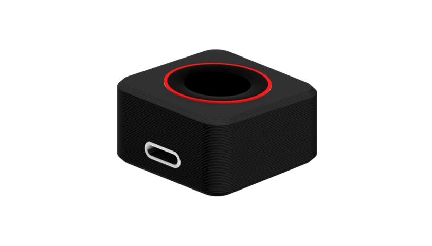

# TinyTouch

  

  <strong>Local biometric unlock for macOS and Linux.</strong> 
  ESP32-S3 biometric hardware. Your fingerprint, device pairing, and credentials stay local.

  <a href="https://thangvv-tech.github.io/tinytouch-release/">Website &amp; Web Flasher</a> ·
  <a href="https://github.com/thangvv-tech/tinytouch-release/releases/latest">Latest Release</a> ·
  <a href="LICENSE">All Rights Reserved</a>

## What it does

- Unlock macOS and Linux lock screens with an enrolled fingerprint.
- Keep host credentials encrypted in macOS Keychain or Linux Secret Service, never on TinyTouch.
- Pair one TinyTouch key with up to 8 host computers.
- Run in HID keyboard mode or `CCID` PIV SmartCard mode (`sc_auth` on macOS, PAM PKCS#11 on Linux).
- Flash or update ESP32-S3 firmware from the static site on GitHub Pages or from release bundles.

## Project structure

- [`site/`](site/index.html) — Pure HTML/CSS/JS product guide, macOS & Linux setup, DIY wiring & enclosure docs, FAQ, and Web Flasher.
- [`hardware/case/`](hardware/case/) — Printable STL and STEP enclosure files for ESP32-S3 SuperMini V1/V2 and Seeed Studio XIAO ESP32-S3.
- [`assets/`](assets/) — Product photos and TinyTouch Desktop screenshots.
- [`.github/workflows/pages.yml`](.github/workflows/pages.yml) — GitHub Pages build that bundles `site/`, `assets/`, and the 4 `.bin` images from the latest release `tinytouch-*-firmware.zip`.

## Downloads

[GitHub Releases](https://github.com/thangvv-tech/tinytouch-release/releases/latest) is the canonical source for desktop apps, firmware bundles, and OTA updates:

| Asset | Purpose |
|---|---|
| `tinyTouch-<version>.dmg` | TinyTouch Desktop for macOS |
| `tinyTouch-<version>-darwin-universal.tar.gz` | macOS CLI tools |
| `tinyTouch-<version>-linux-<arch>.deb` | Debian and Ubuntu installer (`amd64`, `arm64`) |
| `tinyTouch-<version>-linux-<arch>.tar.gz` | Portable Linux archive |
| `tinytouch-<version>-firmware.zip` | ESP32-S3 firmware bundle with `flash.sh` and `flash.bat` |
| `tinytouch.bin` | OTA firmware binary for TinyTouch Desktop |

## GitHub Pages deployment

Enable **Settings → Pages → Build and deployment → Source: GitHub Actions**. Every push to `master` or published GitHub Release deploys `site/` with same-origin firmware binaries under `firmware/` so Web Serial flashing works directly from the hosted site.

## Support

[Open an issue](https://github.com/thangvv-tech/tinytouch-release/issues) for bugs, or [request a feature or hardware target](https://github.com/thangvv-tech/tinytouch-release/issues/new?template=feature_request.md).

## License

TinyTouch firmware, desktop software, and release assets are proprietary and distributed for personal use only. See [LICENSE](LICENSE) for details.
